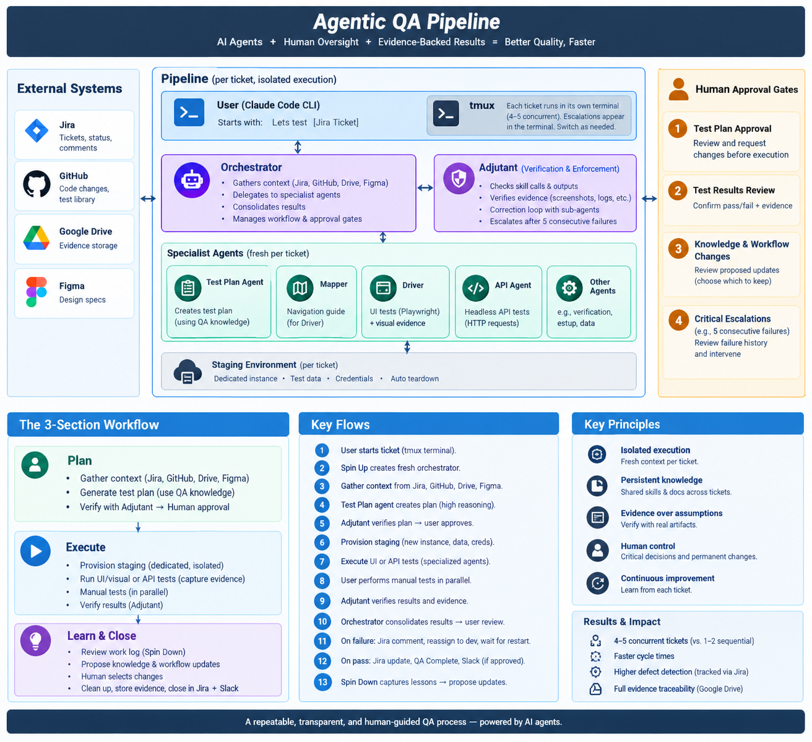

# Agentic QA Automation Pipeline
### A Retrospective Architecture Case Study

**Topics:** Agentic AI · Quality Assurance · Test Automation · Multi-Agent Systems · Human-in-the-Loop Design

## Overview

I built an agentic QA pipeline to help me manage software testing more efficiently while maintaining the level of review and evidence needed to make reliable QA decisions.

The pipeline brought together specialized AI agents, browser and API testing tools, issue tracking, staging environments, and shared QA knowledge. It handled much of the work involved in preparing tests, running them, collecting evidence, and documenting results. I remained involved in reviewing test plans, investigating problems, approving outcomes, and deciding which lessons should carry forward.

The project gave me practical experience designing a multi-agent workflow that could handle several QA work items at once and improve through repeated use.

## Table of Contents

- [Architecture and Workflow](#1-architecture-and-workflow)
- [Planning](#2-plan-preparing-the-tests)
- [Test Execution](#3-execute-running-tests-and-reviewing-evidence)
- [Continuous Improvement](#4-learn-and-close-improving-future-runs)
- [Engineering Decisions](#5-engineering-decisions)
- [Results and Observations](#6-results-and-practical-observations)
- [Lessons Learned](#7-lessons-i-took-away)
- [Conclusion](#conclusion)

## 1. Architecture and Workflow

The pipeline followed three main stages:

1. **Plan:** Gather context and prepare a test plan.
2. **Execute:** Run tests, collect evidence, and review the results.
3. **Learn and Close:** Document the outcome, complete the workflow, and identify improvements for future runs.

A central orchestrator managed each work item and delegated responsibilities to specialized agents. Each agent had its own instructions, defined role, and boundaries. Depending on the task, agents handled test planning, browser interactions, navigation, API checks, or independent verification.

Every work item started with a fresh execution context. Shared QA knowledge and previously approved guidance remained available across runs, allowing the system to benefit from past experience without carrying over another task's working context.

The pipeline also connected several tools used in everyday QA and development, including Jira, GitHub, Playwright, Design tools, and Google drive, along with an internal tool for creating isolated staging environments.

## 2. Plan: Preparing the Tests

When I started a QA run, the pipeline gathered relevant information from the issue, available code changes, design references, previous failure evidence, and existing QA documentation.

A specialized planning agent used that information to build a proposed test plan. The orchestrator organized the work into functional checks, potential automation, and edge cases.

An independent review mechanism checked the workflow's outputs and flagged problems that needed attention. I reviewed the proposed plan and approved it before testing began.

Having a dedicated planning stage helped me catch gaps in coverage before spending time on execution. It also gave me a consistent starting point across different types of work items.

## 3. Execute: Running Tests and Reviewing Evidence

Once the plan was approved, the pipeline selected the appropriate testing approach.

### UI and Visual Testing

For UI work, specialized agents handled browser interactions and navigation. The workflow could search the application repository for relevant Playwright tests, make targeted changes, add coverage where needed, and rerun affected tests to check for regressions.

Visual checks used available design references to evaluate expected behavior and appearance. Screenshots, recordings, and other artifacts helped document failures and explain discrepancies.

I reviewed proposed test-code changes before they were integrated, keeping changes to the application's test suite under human control.

### API Testing

For API-oriented work, a specialized agent sent requests to the staging application and evaluated responses against expected behavior derived from the requirements and available implementation context.

This let the pipeline cover underlying application behavior alongside the user-facing flows tested through the browser.

### Isolated Staging Environments

Each run used a dedicated staging environment with its own test data. This reduced interference between concurrent work items and made retesting after developer changes more predictable.

When a fix was ready for another round of QA, the pipeline could test against an updated environment with fresh test data.

### Verification and Evidence

A separate verification role reviewed reported outcomes against the available evidence. It examined artifacts such as screenshots, recordings, and logs to check whether the conclusions were supported.

When a result did not match the evidence, the workflow could send the issue back for correction. Repeated failures or problems requiring additional judgment were escalated to me.

The orchestrator consolidated the results into a shared report, connecting each test outcome to relevant supporting evidence. I reviewed the findings before making the final QA decision.

### Human Review

I stayed involved at several important points throughout execution:

- Approving the test plan before testing began
- Reviewing results and the evidence behind them
- Handling escalations that needed investigation or judgment
- Reviewing proposed changes to shared QA guidance

These checkpoints helped me maintain oversight as the pipeline took on more of the repetitive work.

## 4. Learn and Close: Improving Future Runs

At the end of each run, the pipeline reviewed the work for lessons that might improve future testing. Potential changes included better test strategies, reusable automation, agent guidance, navigation knowledge, and supporting documentation.

The system proposed changes with an explanation of the reasoning and a comparison against the current version. I reviewed those suggestions and chose which ones to keep.

That review was important because a lesson from one ticket might not apply broadly. My knowledge of the application and the surrounding QA process helped determine which changes were worth making reusable.

The closing stage also consolidated results, preserved relevant evidence in shared storage, communicated the outcome through the team's established processes, and cleaned up temporary working files when they were no longer needed.

Over time, this created a feedback loop between completed QA work and the guidance available to future runs.

## 5. Engineering Decisions

### Giving Agents Clear Responsibilities

I separated the work into specialized roles so that planning, execution, navigation, and verification each had a defined purpose. This made the overall workflow easier to understand and gave me clearer places to investigate when something went wrong.

### Checking Results Against Evidence

I wanted reported outcomes to be supported by observable behavior. Independent verification provided another opportunity to catch discrepancies before they reached the final QA review.

### Keeping Consequential Decisions Reviewable

The pipeline could perform substantial work independently, but I retained approval over test plans, final outcomes, escalations, and changes to shared guidance. This gave me room to scale execution while keeping control over quality decisions.

### Separating Working Context from Shared Knowledge

Fresh execution contexts reduced the risk of one ticket's assumptions carrying into another. Shared, reviewed guidance gave the agents useful knowledge from previous work without requiring every run to start from scratch.

### Maintaining Traceability

Results were documented alongside relevant evidence and connected to the associated work item. This made it easier to explain a failure, review a decision, and communicate the outcome to developers and other stakeholders.

## 6. Results and Practical Observations

In my experience, the pipeline increased the number of QA work items I could manage concurrently from roughly one or two to around four or five.

As execution became more parallel, human review and decision-making became the main constraint on throughput. I could have several work items progressing at once, then move between them as results or questions needed my attention.

I also used issue-tracking data and observations across completed work to assess trends in time per ticket and defect detection. These were directional assessments rather than metrics generated by an automated measurement system. I did not separately measure defects found by automation against those found through manual testing.

The clearest benefit was being able to manage more concurrent QA work while retaining structured test plans, supporting evidence, review checkpoints, and a process for improving future runs.

## 7. Lessons I Took Away

**Independent verification is valuable.** Agents can produce convincing summaries, so checking their conclusions against actual evidence helps catch mistakes that might otherwise go unnoticed.

**Human review needs to fit the workflow.** Approval checkpoints helped me focus attention on test coverage, uncertain results, and changes that would affect future runs.

**Parallel execution changes where time is spent.** Increasing the number of active work items made it easier to keep work moving, although reviewing results still required focused human attention.

**Reusable knowledge needs judgment.** Some lessons apply across many tickets, while others depend on a particular feature or situation. Reviewing proposed changes helped keep shared guidance useful.

**Good QA includes communication and evidence.** A test result becomes much more actionable when developers can see what happened, understand the impact, and inspect the supporting proof.

## Conclusion

Building this pipeline gave me hands-on experience coordinating specialized AI agents across a real QA workflow. The work involved orchestration, execution contexts, verification, staging, evidence, human review, and designing ways for the system to improve over time.

The most important lesson for me was that a multi-agent workflow needs clear boundaries and dependable review mechanisms to be useful in practice. When those pieces worked together, I was able to manage more QA work concurrently and keep the results understandable and reviewable.
